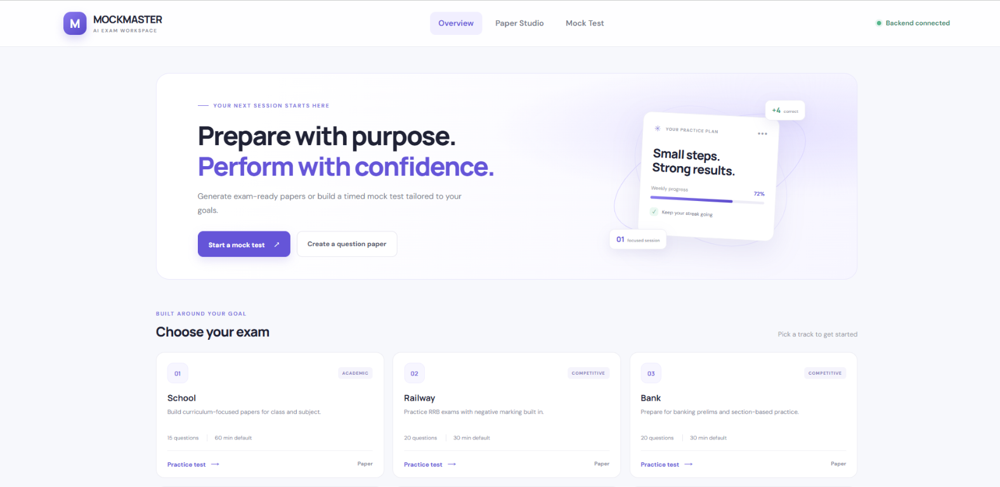
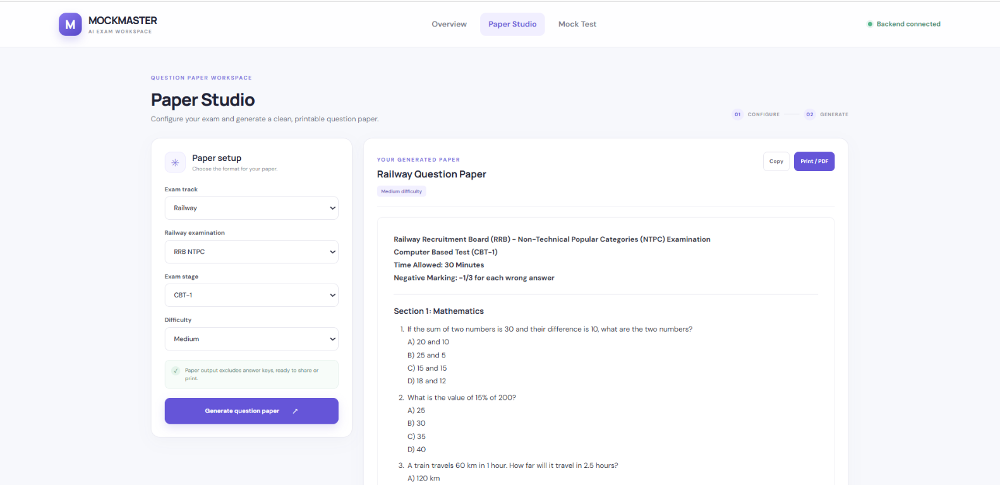
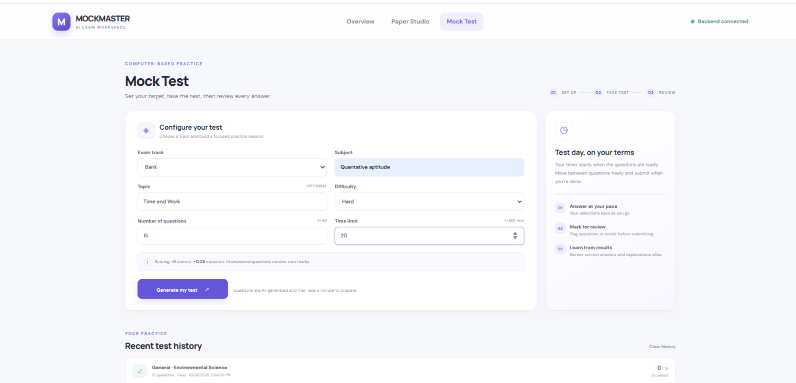
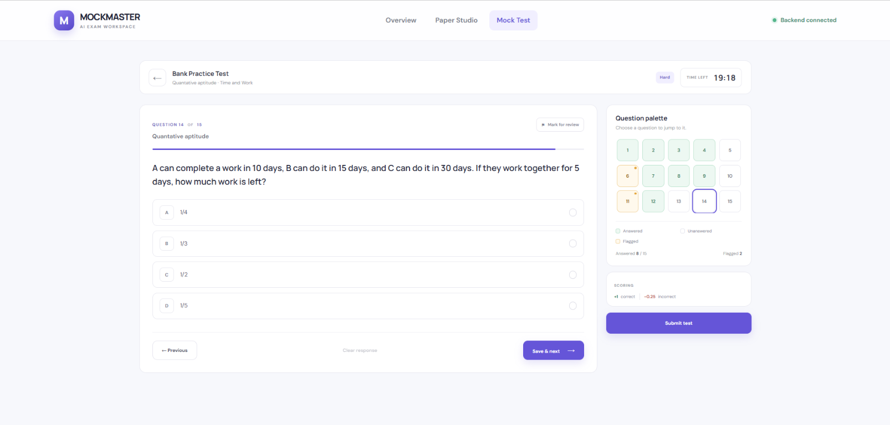

# MockMasterAI

An AI-powered exam workspace for generating question papers and taking timed, interactive mock tests.

[**Live demo**](https://mockmasterai.pages.dev/)

## Screenshots

| Overview | Paper Studio |
| --- | --- |
|  |  |

| Mock test setup | Timed mock test |
| --- | --- |
|  |  |

## Features

- Generate exam-style question papers with printable output.
- Configure and take timed MCQ mock tests with question navigation, review flags, scoring, and results.
- Choose from School, Railway, Bank, JEE Mains, IIT Advanced, and General exam tracks.
- Generate validated questions with an OpenAI model through a FastAPI backend.

## Tech stack

- **Frontend:** React, Vite
- **Backend:** Python, FastAPI, Pydantic, CrewAI
- **AI:** OpenAI API

## Run locally

### 1. Configure the backend

Create `backend/.env`:

```env
OPENAI_API_KEY=your_openai_api_key
OPENAI_MODEL=gpt-4o-mini
```

Install dependencies and start the API:

```bash
cd backend
python -m venv .venv
```

Activate the virtual environment (`.venv\Scripts\Activate.ps1` on Windows, or `source .venv/bin/activate` on macOS/Linux), then run:

```bash
pip install -r requirements.txt
uvicorn main:app --host 127.0.0.1 --port 8000 --reload
```

### 2. Start the frontend

In a second terminal:

```bash
cd frontend
npm install
npm run dev
```

Open the local URL printed by Vite. Keep API keys in environment variables; do not commit them.

## Deployment

The frontend is deployed on Cloudflare Pages and the API on Render. Set `VITE_API_BASE_URL` to the deployed API URL when building the frontend, and set `FRONTEND_ORIGINS` on the backend to the exact frontend origin (for example, `https://mockmasterai.pages.dev`) so the browser can make cross-origin requests.

## Project layout

```text
backend/                 FastAPI API and AI question generation
frontend/                React application
docs/screenshots/        Application screenshots
```
